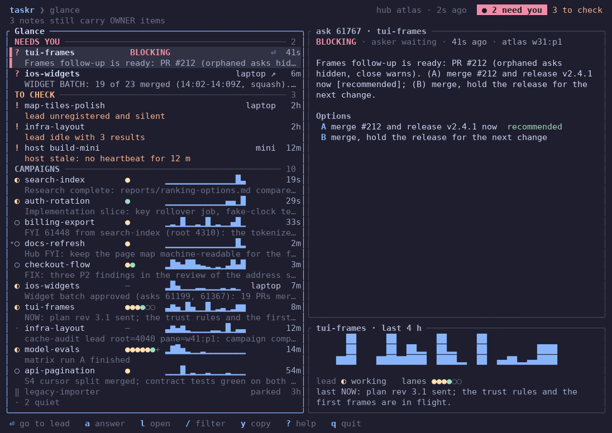
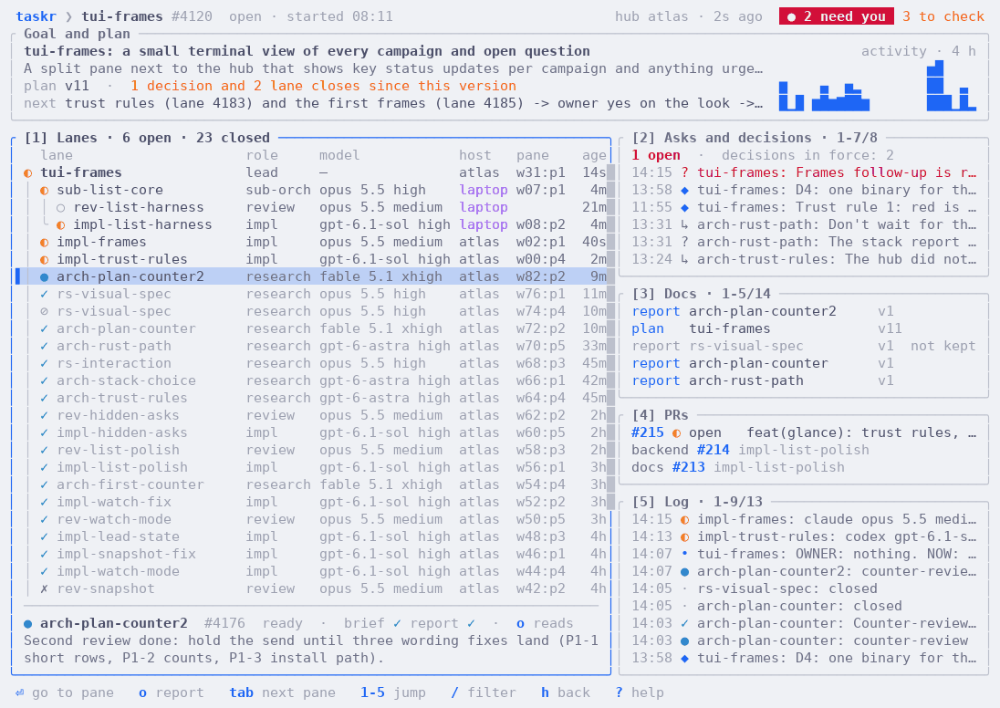

# taskr-tui: the owner's terminal view

`taskr-tui` shows the ledger in a terminal pane: what needs you first, then
every campaign. It reads through the `taskr` command, so it works on the hub
and on client hosts alike.

## Get it

`install.sh` installs `taskr-tui` beside `taskr` (see the [install guide](install.md)).
Or build it from a clone of this repository:

```sh
cargo install --path crates/taskr-tui
```

`rust-toolchain.toml` pins the Rust version; `rustup` installs it on first
use. `cargo build --release -p taskr-tui` leaves the binary in
`target/release/taskr-tui` if you prefer not to install it.

## Start it

```sh
taskr-tui            # your ledger
taskr-tui --demo     # invented data: no ledger is read, no key sends anything
```

| Option or variable | Effect |
| --- | --- |
| `--theme dark\|light\|terminal` | Pick the theme. Default: taken from the terminal's background. `TASKR_THEME` does the same. |
| `--ascii` | Draw with ASCII characters only. |
| `--demo` | Show invented data and write nothing. |
| `NO_COLOR` | Turn colour off. |
| `TASKR_BIN` | The `taskr` binary to read from. Default: `taskr` on `PATH`. |

It needs a terminal. In a script, `taskr glance` prints the same snapshot as
one line of JSON.

## Glance



The first screen has eleven switchable panels, top to bottom:

- **Needs you:** open owner asks. Red in the header means an open owner ask. `BLOCKING` marks an ask whose work has stopped for your answer.
  `HUB` marks a question the hub relayed from its own dialog
  (`taskr ask --dialog`). `◆` marks a structured ask (`taskr ask --question`),
  whose options carry descriptions and a recommendation; `◇` marks an ask
  whose options were found in its text.
- **To check:** things that may need a look but are not questions: a lead
  that went silent, a lead sitting on finished results, a host whose daemon
  stopped reporting. These are amber.
- **Open PRs:** repository-wide open PRs read directly by the installed `gh` on
  the TUI host, using that host's existing gh authentication. Each PR has one
  square and a CI word, author and creation age. Failing checks are red only
  inside this panel; the header verdict remains about owner asks. This differs
  from campaign PR references and the hub watcher's tracked-PR observations.
- **Shipped:** cached PRs merged within the rolling last 24 hours, grouped by
  author across configured repos. Counts are observed samples; author details list
  titles, repo and PR number. The window expires on the existing UI tick, without
  fetching or changing the identity of an unrelated selection.
- **Build queue:** observed running and queued GitHub Actions runs, workflow,
  branch, age and exact state. Unknown states are disclosed separately.
- **Decisions (7):** the goal summary, plan version and plan-document metadata,
  and the decisions in force of one campaign: the last one you opened with `l`
  (or `o` on a row of these panels), as cached when it was read, with its name,
  id and read age. Until you open one it says so. Moving the cursor never
  changes it, and Glance `r` does not refresh it; `l` or `o` reads it again and
  `esc` returns to the glance. A failed read keeps the last good one and shows
  the error.
- **Fleet (8):** one row per campaign the glance lists, with working, ready and
  open lane counts as reported and the lead's state. A count the snapshot left
  out shows `?` and marks the totals `+?`. It covers listed campaigns only, not
  every host or agent, and works with Campaigns hidden.
- **Decision log (9):** decision events in the same cached read's recent log
  sample (up to 100 events), apart from the decisions in force.
- **Issues (0):** GitHub issues of `trip-to-japan/trip` only, one row per
  current assignee plus Unassigned (an explicitly empty assignee list): open,
  blocked and closed in the rolling last 24 hours. Blocked means an open issue
  labelled exactly `blocked` or `needs-info`, counted once. An issue with
  several assignees counts in each group, so groups overlap; the headline
  counts unique issues. Groups with blocked issues use the amber attention
  colour, never red. Rows are informational: no key acts on them.
- **Health (H):** the hub's latest `HEALTH` note for `trip-to-japan/trip`
  `production`: the reported SHA, deploy state, Sentry state or issue IDs, the
  checked time with its age, the source note ID and the rollback note ID. It is
  a hub report as of its checked time, not live production state: it never
  calls the environment healthy, does not compare the SHA with `main`, and
  does not resolve or act on the rollback note. A failed deploy or new Sentry
  issues use the amber attention colour, never red; pending and unknown stay
  neutral. One informational row; no key acts on it.
- **Campaigns:** every open campaign with its lead's state, one dot per
  lane, four hours of activity as a small graph, and its latest milestone.
  Quiet campaigns fold into one line at the bottom.

Press `1` (asks), `2` (checks), `3` (campaigns), `4` (Open PRs), `5` (Shipped), `6` (Build queue),
`7` (Decisions), `8` (Fleet), `9` (Decision log), `0` (Issues) or uppercase `H`
(Health) in Glance to show or hide a panel; lowercase `h` stays back. The
switch row uses `+` for shown and `-` for hidden. The first six start
enabled, 7-9, 0 and H hidden; narrow, the hidden five fold into
`7-9,0,H off`. Hidden owner asks
remain counted in the header. Hidden rows cannot receive actions. Rows of
7-9 are informational: only `o` acts on them, opening their campaign. `/`
filters Fleet by name, not 7 or 9. All panels
can be hidden; `1`–`9`, `0` and `H` restore them. Campaign's `1`–`5` keys still select panes.

Visibility and the repository list live in `$XDG_CONFIG_HOME/taskr/tui.json`,
or `~/.config/taskr/tui.json` when XDG_CONFIG_HOME is unset:

```json
{"panels":[true,true,true,true,true,true,false,false,false,false,false],"repos":["trip-to-japan/trip"]}
```

Existing four-, six-, nine- and ten-boolean configs keep their choices and
repo list; the panels they predate take their defaults (Shipped and Build
queue enabled, 7-9, Issues and Health hidden). Saves use eleven booleans.
The `repos` list does not change the Issues or Health repository. Other lengths or
non-boolean entries are invalid and retain the bad-config preservation guard.
Up to eight `owner/repo` names are accepted. Toggle saves preserve the repo
list and replace this allowlisted config atomically with mode 0600. Bad or
unreadable config uses defaults with a visible warning. Toggles then apply
only to this session and preserve the existing file and warning; repair the
config and restart to enable saving. A failed save keeps
the runtime choices and shows a warning. Demo resolves no user config path,
reads or writes no config, and runs no external tool. No private PR data or
credentials are saved.

Open PRs makes one bounded `gh pr list` invocation per visible repository
every 60 seconds. `r` can request a refresh after five seconds, but cannot
bypass failure backoff or a known rate-limit deadline. Hiding the panel or
leaving Glance stops scheduled reads; an in-flight read can finish. Reads
have a ten-second process deadline and bounded output. Failures retain the
last good result with its own stale label; a first failure says unavailable.
Ledger, Open PRs, Shipped and Build queue freshness are independent. Errors show generic messages.

Each query returns at most 100 PRs; at that limit the source says
“first 100; more may exist.” Rows are failing, running, unknown, passing,
then drafts, newest update first within each group. Passing means at least
one observed successful check and no observed pending, failing or unknown
outcome; neutral or skipped alone cannot prove passing. At 100 returned check
contexts completeness is unknown, so passing is forbidden and the row says
truncated. This is observed CI, never merge readiness or required-check
approval. Cheap reviewDecision is shown when supplied; unresolved threads
are not queried. The list shows a bounded window with an overflow count;
`j`/`k` browse it without displacing all asks. No key runs commands from PRs
or opens a browser.

Shipped makes one `gh pr list --state merged --limit 100 --search
merged:>=<UTC-cutoff> --json number,title,author,mergedAt` call per repo every
120 seconds while visible. Invalid and future merge timestamps are excluded;
local window filtering also expires cached rows. At 100 returned items the
source still says “first 100; more may exist” even after window expiry.

Build queue makes one `gh run list --repo OWNER/REPO --limit 100 --json
databaseId,status,conclusion,createdAt,updatedAt,workflowName,headBranch,url`
call per repo every 60 seconds while visible. Active states are `in_progress`,
`queued`, `waiting`, `pending`, and `requested`; completed runs are excluded.
It always labels the latest100-run sample, including underfull results and
zero active observations. Older active runs may be missing: zero observed
never means the repository is idle. No per-status or per-PR queries are made.
These informational rows cannot answer, park, focus agent panes or mutate
ledger data. All external sources share the same timeout, throttle and failure
backoff rules, with at most one in-flight call per source/repo (24 at eight
repos). Auth remains local to the TUI host; nothing private is cached to disk.

Issues makes one pair of sequential `gh issue list --repo trip-to-japan/trip
--limit 100 --json number,state,assignees,labels,closedAt,updatedAt` calls,
`--state open` then `--state closed --search closed:>=<UTC-cutoff>`, at most
once per five minutes while visible, failure retries included (5, 10, then 15
minutes, or a longer known provider deadline). `r` never hurries it. Both
calls share one ten-second deadline and the same output bound. Either
failing keeps the whole last good pair, labelled stale; a first failure says
unavailable, never zero. Missing or malformed counts, assignees, labels,
states or timestamps make the pair unavailable, as does any issue with 100 or
more assignees or labels, whose completeness is unknown. Each read is a
sample: at 100 rows it says “first 100; more may exist”, and the two reads are
not atomic; an issue seen in both keeps its later update. Closed counts use
`closedAt` and expire on the UI clock without a fetch. Never enabled, hidden
or in demo it makes no calls.

Health makes one `taskr --json log 2899 --limit 100` call (the `taskr` that
`TASKR_BIN` names, without the lane's `TASKR_TASK` or `TASKR_LAUNCH`), at
most once a minute while visible; `r` does not hurry it, hiding and showing
does not reset the minute, and failures back off from one minute, doubling
to 15.
One read runs at a time, with a ten-second deadline through parsing and the
same output bound; it makes no `gh` or third-party call. The newest root
`note` event whose summary starts exactly `HEALTH ` decides (a note without
text is not a candidate): it must be one
line of exactly the seven keys `repo env sha deploy sentry checked
rollback`, any order, single spaces, printable ASCII, for this repository
and environment, a ten-digit hex SHA, `live|failed|pending`,
`clean|pending|new:<IDs>`, a UTC `checked` time not after the read, and a
positive rollback note ID. A malformed latest note, one for another
repository or environment, a future checked time, or no such note in the
last 100 hub events shows unknown and replaces any earlier report; an older
note never stands in for it. A failed or malformed read keeps the last
result, labelled stale; a first failure says unavailable. Every message is
generic. A newer note with an older checked time still wins, and shows its
age; there is no expiry, because the hub writes after deploy checks, not on
a schedule. Never enabled, hidden or in demo it reads nothing (demo shows an
invented note).

Scheduled cost is about 60 Open PR + 30 Shipped + 60 Build queue = 150 gh
invocations per repo per hour per instance (1,200 at eight repos), plus at
most 24 for Issues (one repository) and manual refreshes. Health adds at
most 60 `taskr` reads per hour per instance and no `gh` calls. This is not a fixed network-request or GraphQL-point
budget; several TUI instances multiply the traffic. Failure backoff caps at
15 minutes except when a longer known provider deadline applies.

The header shows which hub the data comes from, how old it is, and the
verdict: **no owner action**, **N need you** or **N to check**. The pane on
the right shows the selected row in full. When its text is longer than the
pane, the title says which lines show (`9-34/34`): `tab` past the last
section, or a click, focuses the pane, and the keys below scroll it. In a
terminal under 100 columns there is no right pane; `a` shows an ask's full
text in the answer dialog, which scrolls with `ctrl-d` `ctrl-u` and `PgDn`
`PgUp`.

The view refreshes every five seconds. If the ledger stops answering, the
frame is marked stale and keeps the last data.

## Campaign



`l` on a campaign opens it. Five panes, numbered in their titles:

1. **Lanes:** the tree of workers under the lead, with role, model, host,
   pane and age. Closed lanes show their outcome.
2. **Asks and decisions:** open and answered questions, and the decisions in
   force.
3. **Docs:** captured briefs, reports, the goal and the plan. `o` reads one.
4. **PRs:** pull request references the campaign recorded.
5. **Log:** the newest events.

`c` on the glance lists every campaign, closed ones included.

## Slotr

`s` on the glance or a campaign shows slotr, the hub's memory-aware run
queue, as `taskr slotr` reads it; `s` again closes it. The top lines are the
machine: free memory, the reserve slotr keeps back, how much more its
holders may still take, pressure (PSI over 10 s and 60 s), load, and the
last stop. Then one block per pool: slots in use and whether one more run of
the pool's default cost would be admitted now; each holder with its
campaign, purpose, time held, lease left, memory in use of its cost, and its
task, pane and run; and the queue in order, with why each run waits and for
how long. `▲` marks a priority run. Amber marks a holder slotr is stopping,
warning or about to yield, and a wait on memory, pressure, load or recovery.

The view reads slotr every three seconds while it is open, and not at all
while it is closed. `Enter` and `y` work the row's pane, and `l` opens the
row's campaign. When slotr cannot be read, a line says why and the last good
pools stay, dimmed. Runs that wait on the old heavy flock show only as
`legacy_lock` with the holder's pid, until slotr manages the heavy lock.

## Keys

`?` shows this list in the view; it is the same table the code uses.

| Key | Does |
| --- | --- |
| `j` `k`, arrows | Down, up |
| `g` `G` | First, last row |
| `ctrl-d` `ctrl-u` | Half a page |
| `PgDn` `PgUp` | A page (the focused detail, a document, the answer dialog) |
| `tab`, `shift-tab` | Next or previous section, then the detail pane (glance), or pane (campaign) |
| `1`-`9`, `0`, `H` | Show/hide a Glance panel (remembered; `0` is Issues, `H` Health) |
| `1`-`5` | Jump to a pane (campaign) |
| `Enter` | Go to the row's agent pane in Herdr |
| `l` | Open the campaign |
| `h`, `esc` | Back, close; from the detail pane, back to the list |
| `/` | Filter rows by name; search in a document |
| `c` | All campaigns, closed too (glance) |
| `s` | Slotr: who holds a slot and who waits; `s` again closes |
| `a` | Answer the selected ask |
| `p` | Park or unpark a campaign (asks first) |
| `o` | Read the report or document; on a Decisions, Fleet or log row, open its campaign |
| `y` | Copy the command that jumps to the row's pane |
| `r` | Refresh now |
| `m` | Mouse on or off |
| `t` | Theme: dark, light, terminal |
| `?` | Help |
| `q` | Close; quits on the glance |
| `space` | Page down (in a document) |

The mouse works too: click selects, double-click is `Enter`, the wheel
scrolls the pane under it.

With the glance's detail pane focused, `j` `k`, `g` `G`, `ctrl-d` `ctrl-u`
and `PgDn` `PgUp` scroll it instead of moving the cursor. Moving the cursor
starts the next row's detail at its top.

### What the keys change

Most keys only read. Three do more:

- **`Enter`** focuses the agent's pane. It works when `taskr-tui` runs in a
  Herdr pane and the agent's pane is on the same machine (the row shows `⏎`); for a pane on another machine (`↗`) use
  `y` to copy the command and run it there. Focusing moves every client
  attached to that Herdr server.
- **`a`** records your answer with `taskr answer`. If the ask lists options
  like `(A) ...; (B) ...`, the dialog offers them, and you can always write
  your own. A structured ask's options come from its question, with each
  description under its label and `★` on the recommended one. `j` `k`
  choose, `tab` types, `Enter` reviews the answer and `y` sends it. When the
  asker is no longer waiting, the answer is also sent to its pane as a prompt.

  The answer is sent as `B: label`. On a structured ask, `tab` types a note
  after the option, sent as `B: label — note`. When a structured ask allows
  several options, `space` picks or drops the one under the cursor and
  `Enter` reviews the set, sent as `A: OAuth; C: SSO`. `Enter` with nothing
  picked does nothing and says so. An answer longer than its field shows its
  end and the cursor, with `…` before it.
  On a small screen the options give way first: descriptions shorten or go,
  then each label takes one cut line, then the list shows a window around the
  chosen option with `↑ n more` and `↓ n more`.
- **`p`** parks a campaign (`taskr set ROOT glance.state=parked`) or unparks
  it. A parked campaign stays dim; its owner asks stay red.

## Marks

| Mark | Meaning |
| --- | --- |
| `?` | An owner ask |
| `!` | Something to check |
| `◐` | Working |
| `○` | Waiting |
| `●` | A lane; a ready lane |
| `·` | Idle |
| `×` | Gone |
| `‖` | Parked |
| `✓` `⊘` `✗` | Closed: done, abandoned, rejected |
| `⏎` `↗` | The pane is on this machine; on another |
| `•` | Changed since you last looked |
| `◆` `◇` | A structured ask; options found in an ask's text |
| `★` | The recommended option of a structured ask |
| `HUB` | The hub relayed this ask from its own dialog |

`--ascii` replaces these with plain characters.
